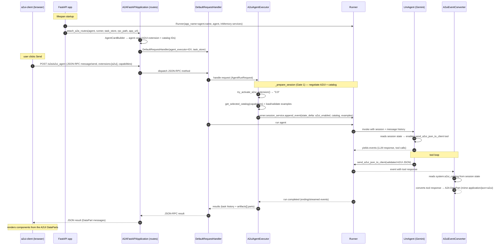

# 07 — A2A request flow across the components

How the `FastAPI app`, the `request handler`, the `executor`, and the `runner`
work together for one incoming A2A request. It complements [03-flow.md](03-flow.md)
(step-by-step) and [02-architecture.md](02-architecture.md) (the pieces) by
showing the runtime hand-offs between those four objects.

## Roles at a glance

| Component | File (this repo) | Job |
|---|---|---|
| **FastAPI app** | `app/fast_api_app.py` | HTTP host; at startup builds the agent + runner and mounts A2A routes |
| **A2AFastAPIApplication** | (a2a-sdk) via `app/app_utils/a2a.py` | Mounts `POST /a2a/a2ui_agent` + agent card onto the app |
| **request handler** | `DefaultRequestHandler` (a2a-sdk) | Dispatches A2A JSON-RPC methods onto the executor; tracks streaming tasks |
| **executor** | `app/agent_executor.py` (`A2uiAgentExecutor`) | Negotiates the A2UI extension + catalog, stores state, converts output |
| **runner** | ADK `Runner` | Holds sessions/state, runs the agent, yields streamed events |
| **converter** | `A2uiEventConverter` (a2ui-agent-sdk) | Turns `send_a2ui_json_to_client` tool output into A2A `DataPart`s |

## How the four objects fit together

The chain is **layered**: each object only talks to its neighbour, and the hand
between the executor and the runner is the one that carries the A2UI context.

1. **FastAPI app** is the outermost shell. It does **not** itself understand
   A2A. At startup it builds the `Runner` and calls `attach_a2a_routes(...)`,
   which hands everything off to the A2A stack.
2. **A2AFastAPIApplication** translates "HTTP request at this path" into
   "A2A JSON-RPC call". It mounts the endpoints and builds the agent card
   (the discovery contract clients fetch).
3. **DefaultRequestHandler** translates "A2A JSON-RPC call" into "run the
   agent". It decides between a plain `message/send` and a streaming/long
   task (`message/sendStreaming`), using the `task_store` for the latter.
4. **A2uiAgentExecutor** sits *inside* the handler. It decides *how* the agent
   should behave for this session — most importantly whether A2UI is active —
   and it converts the agent's output back into A2A parts.
5. **Runner** actually executes the agent. It owns the session/state/memory
   and emits a stream of events the executor's converter watches.
6. **A2uiEventConverter** (registered on the executor) is the tail end that
   changes tool responses into the `DataPart`s the client renders.

Nothing talks to anything else directly: the request goes in the top
(HTTP) and comes back out the top (JSON), while the A2UI context threads
through the middle via the runner's sessions.

## Sequence diagram (A2UI path)

## Open the diagram step by step

The numbered boxes in the diagram above map to these moves (A2UI path):

**Startup (1–4)**
1. The app builds a `Runner` bound to the `LlmAgent` with in-memory
   session/artifact/memory services and `auto_create_session=True`.
2. `attach_a2a_routes(...)` builds the **agent card**, which advertises the
   ADK executor extension *plus* the A2UI extension and its
   `supportedCatalogIds` — this is what a client fetches to learn the agent
   can render A2UI.
3. The card, the executor, and a shared `task_store` are handed to a
   `DefaultRequestHandler`.
4. The handler is mounted onto the app by `A2AFastAPIApplication`, so
   `POST /a2a/a2ui_agent` now serves A2A JSON-RPC.

**Request in (5–6)**
5. The client POSTs a `message/send` carrying the A2UI `extensions` and the
   `a2uiClientCapabilities.supportedCatalogIds` metadata.
6. The route dispatches to the handler, which turns the JSON-RPC method into
   an `AgentRunRequest` for the executor.

**Session preparation (7–9, the Gate 1 negotiation)**
7. `A2uiAgentExecutor._prepare_session` runs `try_activate_a2ui_extension()`;
   it finds the A2UI URI in the client's extensions and activates version
   "0.9".
8. It reads the client's supported catalog IDs, picks the matching catalog via
   `get_selected_catalog(...)`, and loads + validates the few-shot examples
   (rewriting the placeholder `catalogId` to the deployed URL).
9. It folds all of that into **session state** by appending an event through
   `runner.session_service.append_event(...)` under the keys
   `a2ui_enabled`, `a2ui_catalog`, and `a2ui_examples`. The runner now knows
   this session is an A2UI session.

**Agent run (10–12, the tool loop)**
10. The handler asks the runner to run the agent for this session.
11. The agent's toolset checks session state, sees A2UI is enabled, and
    exposes the `send_a2ui_json_to_client` tool, injecting the catalog schema
    + examples into the LLM request.
12. Gemini decides the request is a UI request, builds an A2UI message list
    from the catalog, and calls `send_a2ui_json_to_client` (which validates
    the payload against the catalog before accepting it). The runner streams
    the resulting events.

**Output conversion (13–15)**
13. The `A2uiEventConverter` (configured on the executor) sees the tool
    response, reads the catalog from session state, and converts each A2UI
    message into an A2A `DataPart` with mime `application/json+a2ui`.
14. The executor returns the results (task history + `artifacts[].parts`) up
    through the handler and out of the HTTP layer.
15. The client receives the JSON result and renders the components from the
    `DataPart`s.

## The load-bearing connection

The executor and the runner share session state through
`runner.session_service.append_event(...)`. That single hand-off is what lets:

- the **toolset** learn A2UI is active and inject the catalog schema + examples,
- the **converter** find the catalog to convert and validate the tool output,

without the executor holding mutable per-request objects directly. Everything
flows through the runner's sessions and its streamed event loop. In this repo
the executor subclasses ADK's own `A2aAgentExecutor` and overrides only
`_prepare_session`; the base class supplies all the request/task/streaming
machinery, so the pieces above need no bespoke glue between them.

> The two gates from [01-overview.md](01-overview.md) live in this diagram too:
> **Gate 1** is step 7 (the executor's extension check), and **Gate 2** is step
> 12 (the model's decision to emit UI vs. plain text).

Next: [README.md](README.md) for the navigation index.